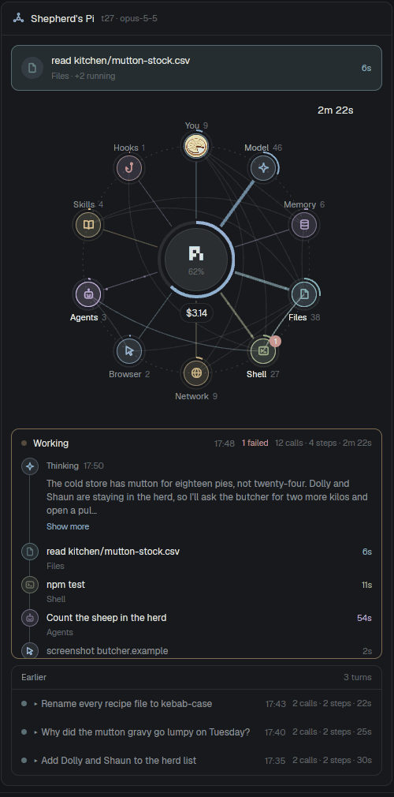

# Shepherd's Pi

A live map of what [pi](https://github.com/earendil-works/pi) is doing, in a panel of the [Herdr app](https://herdr.dev). Every tool call sends packets from pi to a station: files, shell, network, memory, skills, subagents. You see the agent at work instead of reading a list of commands.



<sub>A made-up session, about shepherd's pies and a herd of sheep. [Video (MP4)](docs/demo.mp4).</sub>

## Install

You need the Herdr app, and pi running in a terminal inside it.

```sh
pi install git:github.com/chapmandu/shepherds-pi
```

Restart pi, then type `/shepherds-pi` to open the map beside the chat.

On its first start inside Herdr, the extension copies the panel into `~/.config/herdr-app/mods/shepherds-pi`, and again after each update of the package. It changes nothing else in Herdr. If you edit that copy, an update will overwrite it: to change the panel, duplicate it first (`herdr-app do mod.clone '{"name":"shepherds-pi","as":"my-map"}'`).

Update with `pi update`. Remove with:

```sh
pi remove git:github.com/chapmandu/shepherds-pi
rm -rf ~/.config/herdr-app/mods/shepherds-pi ~/.cache/shepherds-pi
```

<details>
<summary>Without <code>pi install</code></summary>

Clone this repository anywhere and run `./install.sh`. It copies the panel into Herdr and links the extension into `~/.pi/agent/extensions/shepherds-pi`. Run it again after pulling changes.
</details>

<details>
<summary>As a tab of Herdr's side panel, next to Files and Changes</summary>

Herdr's own layouts and mods are read-only, so this works on your own copies. Skip the clone commands if you have them already.

1. Copy the layout and the tab bar:

   ```sh
   herdr-app do layout.clone '{"name":"main","as":"my-main"}'
   herdr-app do mod.clone '{"name":"tabs","as":"my-tabs"}'
   ```

2. In `~/.config/herdr-app/layouts/my-main.json`, change the block with `"content": { "mod": "tabs" }` to `"my-tabs"`, and add this to the `children` of the stack with `"id": "panel-body"`:

   ```json
   { "id": "map", "type": "block", "content": { "mod": "shepherds-pi" } }
   ```

3. In `~/.config/herdr-app/mods/my-tabs/main.js`, add `"map"` to the list that starts `const enabled =`, and a button beside the Files and Changes ones:

   ```js
   .child(panelButton("map", "Map", "mods/shepherds-pi/map.svg"))
   ```

4. Run `herdr-app check ~/.config/herdr-app/mods/my-tabs`. A **Map** button now opens the panel.
</details>

### If something is wrong

- **"Nothing yet".** Restart pi after installing. Check that pi runs inside Herdr: `echo $HC_TERMINAL_ID` should print something like `t27`. Click the pi terminal, so the map follows it.
- **pi runs in a sandbox.** Allow writing to `~/.cache/shepherds-pi` (the map) and `~/.config/herdr-app/mods` (the panel), or install the panel with `./install.sh`.
- **`/shepherds-pi` fails.** The Herdr app must be running; the command uses `herdr-app`.

## What it shows

- **Now:** what the agent is doing this moment: the call, its station, how long it has run, how many run beside it. "Working · Between steps" in the gaps. "Waiting for you", bright and pulsing, once the answer is ready.
- **The map:** ten stations round pi.
  - A call sends a short train of packets out to its station when it starts, and back when it ends (red if it failed).
  - A working station's glow brightens and dims, and packets keep moving on its spoke; everything fades in and out.
  - An arc round each station shows its share of the session's work.
  - Every path the agent took between stations stays as a faint curve; packets run along it when it is used again.
  - A red badge counts a station's errors since your last message.
  - The centre shows how full the context window is (amber from 70%, red from 90%); under it, the session's cost as pi's footer counts it; top right, how long the turn has run.
  - Your account picture stands for you, when the system has one.
- **Activity**, each part scrolling on its own:
  - The latest turn: the agent's thinking and its calls on one timeline, newest at the top. Thinking shows as plain words, without code or markdown; a long one opens on click. Its replies are in the chat already, and your messages are left out.
  - Earlier turns: one line each, titled by what you asked. Click to open.

| Station | When |
| --- | --- |
| You | your messages, questions to you |
| Model | each model step, compaction, a change of model |
| Memory | paths with `memory/` or `MEMORY.md`, tools with "memory" or "recall" in their name |
| Files | read, write, edit, grep, find, ls, and shell commands that only work on files (`cat`, `rg`, `mv`, `sed`…) |
| Shell | every other shell command, `codemode` |
| Network | web tools, MCP tools, and commands that reach the network (`curl`, `gh`, `git push`, `npm install`…) |
| Browser | browser tools |
| Agents | subagents and workflows |
| Skills | reading a `SKILL.md`, skill tools, tool search |
| Hooks | a call another extension refused |

## What it keeps

Call labels hold names, never content: a command's name, the last two parts of a path, a web host, a tool's name, a subagent's short description. The agent's thinking is kept as plain words, without code, at most 600 characters a step.

Each pi session keeps its last 60 events in `~/.cache/shepherds-pi/<terminal>.json`, readable only by your user. A recording untouched for a day is deleted the next time pi starts. Nothing leaves your machine.

## How it works

```
extension/        the pi extension: records what pi does, puts the panel into Herdr, adds /shepherds-pi
mods/shepherds-pi/  the Herdr panel: watches ~/.cache/shepherds-pi and draws the focused pi
package.json      makes the repository a pi package
```

- The extension runs only inside a Herdr terminal (`HC_TERMINAL_ID` is set), and only the main session writes: subagents run as more sessions in the same pi and are kept out. It never changes a call, a result or a turn.
- The panel draws the focused terminal's map, else the last one it showed, else the pi that changed last. Movement uses Herdr's own animations.

## Developing

- `npm test` runs every test: how calls are sorted, the clean-up of old recordings, that only the main session writes, how the panel is copied into Herdr, and the panel itself drawn with a sample session.
- `herdr-app check ~/.config/herdr-app/mods/shepherds-pi` draws the panel once with no data; look at the panel too.
- With `./install.sh`, the panel is a copy: run it again after editing. Herdr does not reload a linked mod folder.
- `docs/record-demo.sh <terminal>` records `docs/demo.gif`, `docs/demo.mp4` and `preview.png` from a fictional, busy session (`docs/demo-board.mjs`), and puts your theme and picture back afterwards.
- To show your own picture as You, put it at `~/.config/herdr-app/mods/shepherds-pi/avatar.png`.

## Limits

- This computer only: terminals on other machines are not read.
- pi has no settings hooks, so Hooks lights only for refusals whose message says "blocked", "denied" or "not approved".
- Subagents that run as separate pi processes don't send their calls here.

<sub>After [lot-map](https://github.com/alexeyw/lot-map) by Aleksei Volodin, the same idea for Claude Code.</sub>
