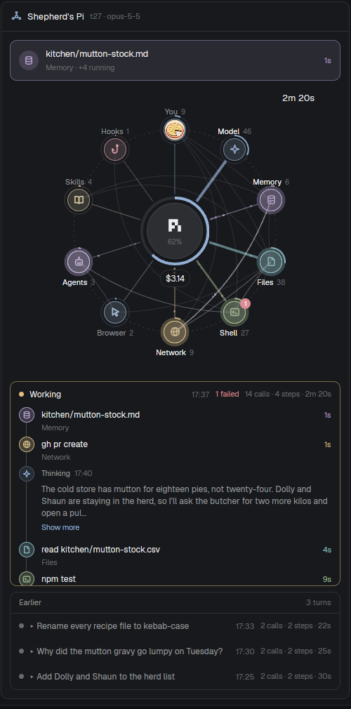

# Shepherd's Pi

A side panel that shows what the pi agent in the focused terminal is doing: a strip of key numbers, a ring of stations that light up as tools run, and the turn's activity as a timeline.

## What you see

Top to bottom, in a card with radius 10 and a 1px `border`:

1. **Header**, 42px: a map icon, "Shepherd's Pi", the terminal id in `dim`, and on the right a status pill: `working` colour dot that pulses with "Working", or `idle` with "Idle".
2. **Strip**, one `surface` card: "Context" with the percentage and a 4px bar (`accent`, `blocked` from 70%, `ansi1` from 90%), the model name, then cost (`$1.27 sub`), calls and errors (red when above 0).
3. **Map**, up to 400px square: ten stations on a dashed ring, centre: pi's logo with a context arc around it. Station order clockwise from the top: You, Model, Memory, Files, Shell, Network, Browser, Agents, Skills, Hooks. Each has its own theme colour (ansi4, accent, ansi5, ansi6, ansi2, ansi3, ansi12, ansi13, ansi11, ansi9) and a 15px line icon in a 32px circle.
4. **Activity**: one card per turn, newest first, at most six.

## How it behaves

- A running call: a dot with a soft halo moves between the centre and the station (native `loop` on left and top), the station gets a pulsing halo, and `×N` when several run.
- A finished call lights its station for 2 s; an error or refusal turns it red and adds a red count badge, cleared by the next message.
- Spokes: a hairline for every station, plus a coloured line 1–4px wide by how much the station was used.
- Route: dashed line through the last six stations (not Model), fading from 40 s to 60 s.
- Answer ready: a ring pulses around the centre for 2.5 s.
- Activity: the latest turn is open, with a yellow-tinted border while working. Rows: icon on a vertical rail, label, station and `+N more` / `failed` / `blocked` below, time on the right. Model steps are not rows; while the model thinks with nothing running, a "Thinking" row shows. Earlier turns show one line (calls, steps, time, failures) and open on click.

## Built from

- `mods/shepherds-pi/main.js`: a `View`. Reads `~/.cache/shepherds-pi/<terminal>.json` with `readTextFile`, wakes on `watchFolder` (falls back to a 1 s timer), re-renders once a second only while something is running or fading. Picks the focused terminal, else the last shown, else any terminal in the focused tab (`panes()`).
- Lines and arcs: `window.paint_path` with `PathBuilder`, layered full size.
- `extension/index.ts`: a pi extension, loaded through `package.json` (`pi.extensions`). Listens to `input`, `message_start`/`message_end` (assistant), `tool_execution_start`/`end`, `model_select`, `session_before_compact`/`session_compact`, `agent_end`. Writes the summary atomically (temp file, rename). Cost sums every usage in `sessionManager.getEntries()`, like pi's footer.
- `extension/classify.ts`: tool name and arguments to station and label. `extension/mod.ts`: copies the panel into the Herdr app on start, once per package version.

## Watch out

- Herdr does not hot-reload a symlinked mod folder, and loses its watch when the folder is deleted and re-created: copy files over the top.
- `herdr-app check` renders once with no data; errors in the async load are silent. Look at the panel with real data.
- Colours must be `#rrggbb[aa]`; alpha is appended by hand.

## Done when

- `herdr-app check` passes and `herdr-app status` shows no errors.
- With pi running in the focused terminal, a bash call makes a dot run to Shell and a row appear at the top of the Working card.
- The cost in the strip matches pi's footer.
- After the answer, the card's title turns to "Last answer" and the status pill to "Idle".
